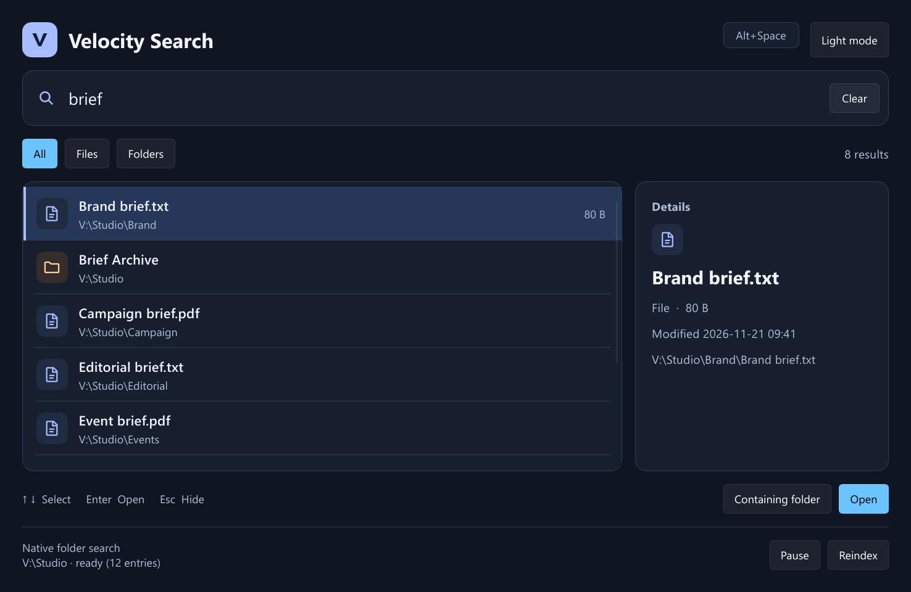

# Velocity Search

A keyboard-first Windows desktop app for finding files and folders. Velocity builds an in-memory filename index for the folders you choose and searches it from a resizable Slint interface built with Rust.



*Desktop screenshot with synthetic project files.*

## What you can do

- Search by filename with case-insensitive substrings, AND terms, quoted phrases, paths, or an extension filter such as `ext:pdf budget`.
- Narrow the displayed results to files or folders. The filter applies to the current result page.
- Inspect a selection’s path and use **Load metadata** to retrieve its size and modification time. Compact windows give the full width to the results list.
- Open a result or its containing folder from the keyboard or the action buttons.
- Switch between light and dark appearance from the window or the system tray.


## Get started

Build the Windows app from this repository’s root with the Rust MSVC toolchain and Visual Studio C++ Build Tools.

```powershell
cargo rustc --release --locked -p velocity-ui --bin velocity-ui -- -C target-feature=+crt-static
Copy-Item config.example.toml .\target\release\config.toml
```

Edit `search.roots` in `target/release/config.toml` to list the absolute paths you want to search. Start the app under your regular Windows account.

```powershell
.\target\release\velocity-ui.exe
```

The app scans readable folders on startup. The bottom of the window reports the indexed count, each root's active backend, and which locations are scanning, ready, unavailable, or skipped. Once a folder is ready, type at least two characters to search it.

| Input | Action |
| --- | --- |
| Alt+Space | Show the search window |
| ↑ / ↓, Page Up / Page Down | Move through results |
| Enter or double-click | Open the selected result |
| Ctrl+Enter | Open its containing folder |
| Escape or close window | Hide the window |

Use **Show search** in the system tray to bring the window back, or **Quit Velocity Search** to exit. If a configured root is unavailable, check its path, connection and permissions, then select **Retry** to recheck the affected scope. Other readable roots stay searchable.

## Configuration

Put `config.toml` beside `velocity-ui.exe`. Add absolute folders under `search.roots`. You can also set `drives.drives` to a list of drive letters such as `['D:']`. Native indexing skips junctions and applies the globs in `excludes.patterns` when `excludes.enabled` is true. A glob such as `**/node_modules/**` excludes the matching subtree. `ui.max_results` controls the displayed page size and `ui.theme` controls the startup appearance. Theme changes made in the window apply to the current session.

**Pause** keeps the previous snapshot searchable. **Resume** and **Reindex** scan the configured roots again. Searches use the last published snapshot during a rebuild. The current folder index rebuilds from disk at launch.

Set `hotkey.key` to change the global shortcut from `Alt+Space`. Windows supports combinations such as `Ctrl+Shift+F9`. The tray can reopen search when a shortcut is unavailable.

Set `search.ntfs_snapshots = true` to use NTFS snapshots for whole local drives such as `D:\`. Velocity checks directory access under the running account before adding names to search, including additional hard-link names. It reads the volume's change journal to update results as files and folders change. After a restart, it validates the saved snapshot in `%LOCALAPPDATA%\Velocity\index`, checks current directory access, and catches up from the saved journal position. A missing, damaged, or outdated snapshot triggers a rebuild. When the account cannot read the volume or its journal, Velocity uses folder indexing automatically. Folder indexing remains the default.

### Everything comparison

For a comparison build, run `cargo build --release --locked -p velocity-ui --features everything` and set `search.backend = 'everything'` in `config.toml`. Start Everything and put `es.exe` beside the executable or on `PATH`, or set `VELOCITY_ES_PATH` to its full path.

## Development

```powershell
cargo build --locked --workspace
cargo test --locked --workspace
cargo run --locked -p velocity-ui
```

| Crate | Role |
| --- | --- |
| [velocity-ui](velocity-ui) | Slint interface, keyboard navigation, tray, and Windows file opening |
| [velocity-everything](velocity-everything) | Process adapter for the Everything CLI |
| [velocity-core](velocity-core) | Provider interface, data types, and configuration |
| [velocity-native](velocity-native) | Native folder index, scoped NTFS snapshots and journal replay, query engine, and Windows change notifications |
| [velocity-mft](velocity-mft) | Experimental NTFS parser and synthetic record tests |

See [standalone search verification](docs/standalone-search-verification.md) for the fixture, tested behavior and release gates.
