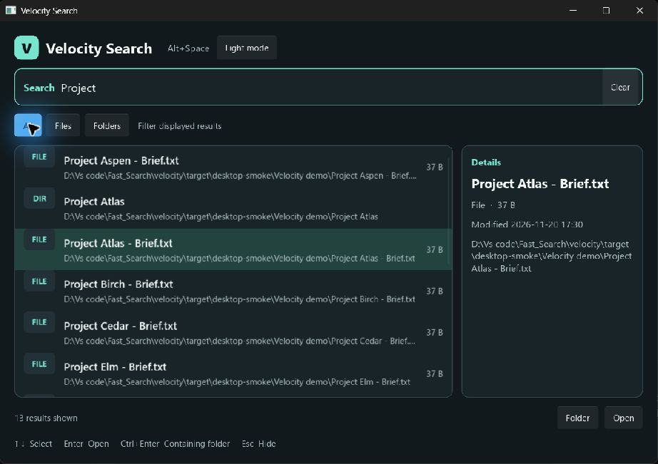
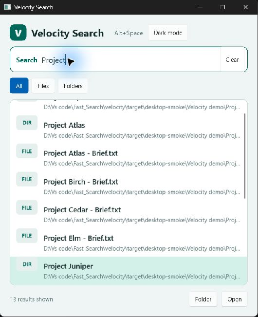
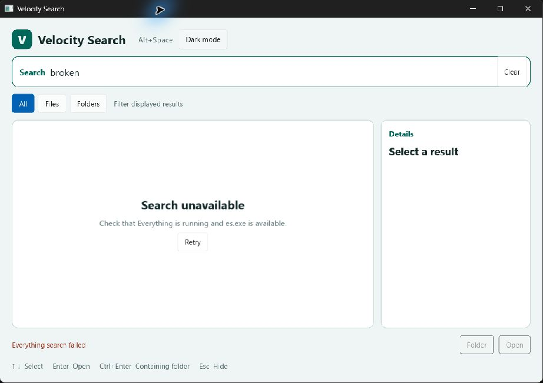

# Velocity Search

A keyboard-first Windows desktop app for finding files and folders. Velocity presents the index maintained by [Everything](https://www.voidtools.com/) in a resizable Slint interface built with Rust.



*Desktop screenshot with synthetic project files.*

## What you can do

- Search by filename or use [Everything search syntax](https://www.voidtools.com/support/everything/search_syntax/), such as `ext:pdf budget`.
- Narrow the displayed results to files or folders. The filter applies to the current result page.
- Inspect a selection’s path, size, and modification time in the details pane. Compact windows give the full width to the results list.
- Open a result or its containing folder from the keyboard or the action buttons.
- Switch between light and dark appearance from the window or the system tray.



## Get started

1. Install and start [Everything](https://www.voidtools.com/downloads/). Let it finish indexing.
2. Download a current [Everything command-line client](https://www.voidtools.com/support/everything/command_line_interface/). Put `es.exe` beside `velocity-ui.exe` or on `PATH`. To point Velocity at a specific executable, set `VELOCITY_ES_PATH` to its full path.
3. From this repository’s root, build and run the Windows app with the Rust MSVC toolchain and Visual Studio C++ Build Tools.

```powershell
cargo build --release --locked -p velocity-ui
.\target\release\velocity-ui.exe
```

The workspace is tested on Windows with Rust 1.97.1. Everything and its command-line client are separate from Velocity.

| Input | Action |
| --- | --- |
| Alt+Space | Show the search window |
| ↑ / ↓, Page Up / Page Down | Move through results |
| Enter or double-click | Open the selected result |
| Ctrl+Enter | Open its containing folder |
| Escape | Hide the window |

Use **Show search** in the system tray to bring the window back, or **Quit Velocity Search** to exit. If search fails, check the Everything prerequisites and select **Retry**.



## Configuration

Copy [config.example.toml](config.example.toml) to `config.toml` beside the executable. The supported desktop options are `ui.max_results` and `ui.theme` (`dark` or `light`). Theme changes made in the window apply to the current session. Configure indexed drives and exclusions in Everything.

## Development

```powershell
cargo build --locked --workspace
cargo test --locked --workspace
cargo run --locked -p velocity-ui
```

| Crate | Role |
| --- | --- |
| [velocity-ui](velocity-ui) | Slint interface, keyboard navigation, tray, and Windows file opening |
| [velocity-everything](velocity-everything) | Process adapter for the Everything CLI |
| [velocity-core](velocity-core) | Provider interface, data types, and configuration |
| [velocity-mft](velocity-mft) | Experimental NTFS parser and synthetic record tests |

The desktop app uses Everything. The experimental MFT scanner assumes a contiguous MFT and requires elevated access for raw-volume testing.
